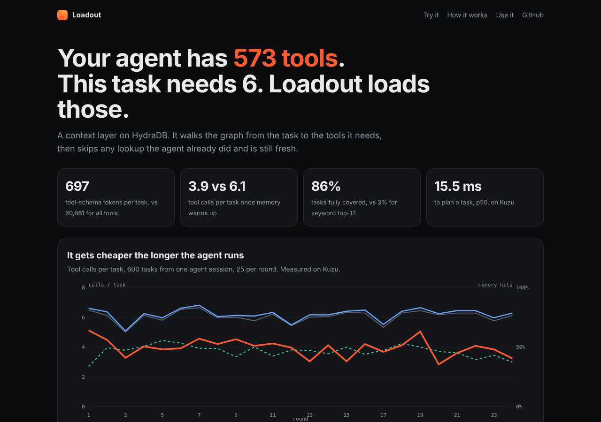

# Loadout

**The context layer for agents, on HydraDB.** Your agent has hundreds of tools. A task needs a handful.
Loadout walks a HydraDB graph from the task to the tools it needs, and skips every lookup the agent already
made and is still fresh.



**Live demo:** _link below once deployed_ · **MCP endpoint:** `<host>/mcp`

## Results

600 tasks from one agent session, replayed against the [ToolLinkOS](https://github.com/EliasLumer/Graph-RAG-Tool-Fusion-ToolLinkOS)
benchmark: 573 tools, each task with the ground-truth set of tools a successful run used.

| Approach | Tasks fully covered | Tool calls per task | Tool-schema tokens per task |
|---|---|---|---|
| Load all 573 tools | 100% | 6.0 | 60,861 |
| Keyword search, top 12 tools | 3% | 7.0 | 1,279 |
| Graph walk, no memory | 86% | 6.2 | 896 |
| **Loadout** (graph walk + memory) | **86%** | **4.3** | **722** |

Calls and tokens are averaged from round 3 on, once memory has warmed up. A task is covered when every tool
its ground-truth run used is loaded, or already answered by fresh memory. A miss falls back to `find_tool`
at one extra call, which the call count includes.

**It improves with use.** Lookups answered from memory go from 29% in the first round to 40% on average after
that. Tool calls per task drop from 6.2 to 4.3 (−31%) while coverage holds. The baseline without memory stays
flat. Setters keep it honest: `set_wifi_status` marks the remembered `get_wifi_status` stale, so memory never
serves an answer the agent itself just changed.

Reproduce: `python -m loadout.evaluate 600` writes `web/results.json`. The live server reruns it on HydraDB at
boot.

## Why it needs the graph

A vector store can rank tool descriptions. Ranking alone covers 3% of tasks, because the tools a task needs
are mostly not the ones it mentions: `share_location_via_email` needs `validate_email` and
`get_current_location`, which needs `get_location_service_status`. Those are `DEPENDS_ON` edges, and the
plan is a traversal:

1. **Target.** Keyword-match the task to 3 target tools.
2. **Walk.** Follow `DEPENDS_ON` up to 3 hops in HydraDB, keeping every tool that depends on each one.
3. **Prune.** Read the agent's `Memory` nodes for the lookups reached. A fresh one replaces the tool, and any
   branch only it needed.
4. **Write back.** After the run, each lookup becomes a `Memory` node with a fresh-until time, setters mark
   theirs stale, and the run is stored as a `Run` node with `USED` edges to its tools.

## Use it from your agent

```json
{ "mcpServers": { "loadout": { "type": "http", "url": "https://<host>/mcp" } } }
```

- `get_context(task, agent)` returns the tool schemas to load and the answers already known.
- `report_run(task, results, agent)` writes back what the run returned.

Plain HTTP works too: `POST /api/plan` and `POST /api/run` with `{"task": "...", "agent": "..."}`.

## Run it

```bash
docker build -t loadout . && docker run -p 10000:10000 loadout   # HydraDB + Loadout in one container
```

The image starts from `ghcr.io/hydra-db/hydradb:0.4.0`, the open-source engine, runs a single node on local
disk, and serves Loadout beside it. For local work without Docker, `pip install -r requirements.txt kuzu` and
`uvicorn app:app` uses selfgraph's embedded Kuzu backend through the same store API.

## Built on

- [HydraDB](https://github.com/hydra-db/hydradb), the open-source graph engine, as the store.
- [selfgraph](https://github.com/hydra-db/selfgraph)'s store layer, which speaks HydraDB's Cypher dialect.
- The tool-dependency retrieval idea from [graph-tool-call](https://github.com/SonAIengine/graph-tool-call) (MIT).
- [ToolLinkOS](https://github.com/EliasLumer/Graph-RAG-Tool-Fusion-ToolLinkOS) (MIT) for the tools, edges and
  ground truth.

The demo's tool runs return simulated values; the planning, traversal and memory are real.

## Limits

- Targets come from keyword matching, so 14% of tasks start from the wrong tool and need `find_tool`.
- Freshness rules are per tool (`loadout/catalog.py`), set by hand for this catalog.
- Memory is per agent id with no auth; the public demo is not a place for real data.

MIT License.
